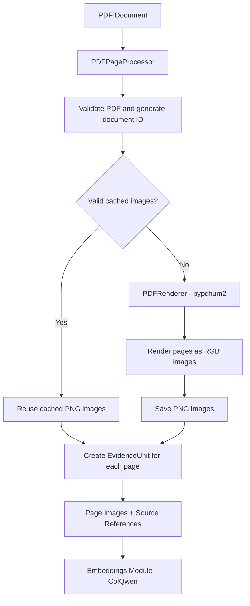

## SemanticLens Documents

### Overview

The **Documents module** prepares PDF documents for Visual Document Retrieval (VDR)

It converts PDF pages into high quality images and creates structured references that connect each image to its original document

**Goal:** Provide reliable, reusable document processing for different visual retrieval models

### How It Works



### What's Inside?

| File | Purpose |
|---|---|
| `config.py` | Rendering resolution, image limits and caching settings |
| `pdf_renderer.py` | Converts PDF pages into RGB images |
| `pdf_processor.py` | Saves images, manages caching and creates evidence records |
| `__init__.py` | Exposes the public API |
| `spatial_page_map/` | Optional structured document parsing using MinerU |

### Example Usage

```python
from pathlib import Path
from semanticlens.documents import DocumentsConfig, PDFPageProcessor

processor = PDFPageProcessor(
    workspace="./lens_data",
    config=DocumentsConfig(dpi=180),
)

for page in processor.process(Path("report.pdf")):
    print(page.page_number, page.image_ref)
```

Each page produces an `EvidenceUnit` containing its source document, page index and saved image reference.

The images can then be used by an embedding model such as ColQwen

### Key Design Decisions

- **Visual first:** Uses full page images without requiring OCR
- **Reliable rendering:** Uses `pypdfium2` and Pillow
- **Caching:** Reuses verified images when document content and rendering settings match
- **Source tracking:** Preserves original PDF references and stable document IDs
- **Memory conscious:** Renders and processes pages individually
- **Extensible:** Rendering and processing are separate allowing new methods or backends later

### Summary

The Documents module transforms **PDF files into reusable page images and source linked evidence** providing a consistent input for SemanticLens embedding and retrieval pipelines
