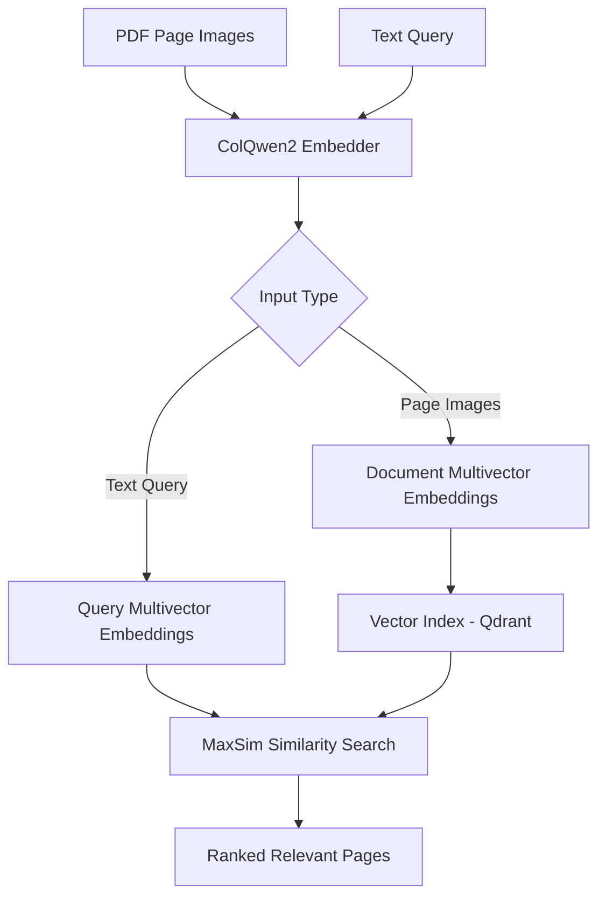

## SemanticLens Embeddings

### Overview

The **Embeddings module** converts document page images and text queries into numerical representations that can be used for Visual Document Retrieval (VDR)

Its purpose is to provide a **modular way to use different embedding models** without changing the rest of the SemanticLens pipeline

> [!NOTE]
> **V1 uses ColQwen2** with support for additional models in future versions

### How It Works



ColQwen2 generates **multiple vectors per page and query** allowing retrieval to compare visual and textual information at the token level

### What's Inside?

| File | Purpose |
|---|---|
| `config.py` | Configures the model, device, precision and batch size |
| `colqwen.py` | Loads ColQwen2 and generates page/query embeddings |
| `__init__.py` | Exposes the public API |

## Example Usage

```python
from semanticlens.embeddings import ColQwenConfig, ColQwenEmbedder
from semanticlens.core import Query

embedder = ColQwenEmbedder(
    workspace="./lens_data",
    config=ColQwenConfig(
        device="auto",
        inference_batch_size=1,
    ),
)

# Pages are EvidenceUnit objects from Documents.
page_vectors = embedder.embed_units(pages)

query_vectors = embedder.embed_query(
    Query(text="Maps showing future warming")
)

embedder.close()
```

The resulting embeddings can be stored and searched using a compatible vector index

### V1 Model

| Property | Choice |
|---|---|
| Model | `vidore/colqwen2-v1.0-hf` |
| Framework | Sentence Transformers |
| Embedding type | Multivector |
| Vector dimension | 128 |
| Retrieval interaction | MaxSim |

The checkpoint revision is pinned in the configuration for reproducibility

### Key Design Decisions

- **Modular:** Implements Core's `Embedder` interface
- **Visual-first:** Encodes complete document page images
- **Late interaction:** Preserves token level vectors instead of combining them into one vector
- **Memory-conscious:** Supports configurable inference batching
- **Reproducible:** Tracks model and preprocessing information through `EmbeddingSpec`
- **Extensible:** Other embedding models can be added through separate adapters

### Future Models

```text
embeddings/
├── colqwen.py      # V1
├── colpali.py      # Future
└── new_model.py    # Future
```

New models can follow the same `Embedder` interface. Models with incompatible embeddings require their own index or re indexing
