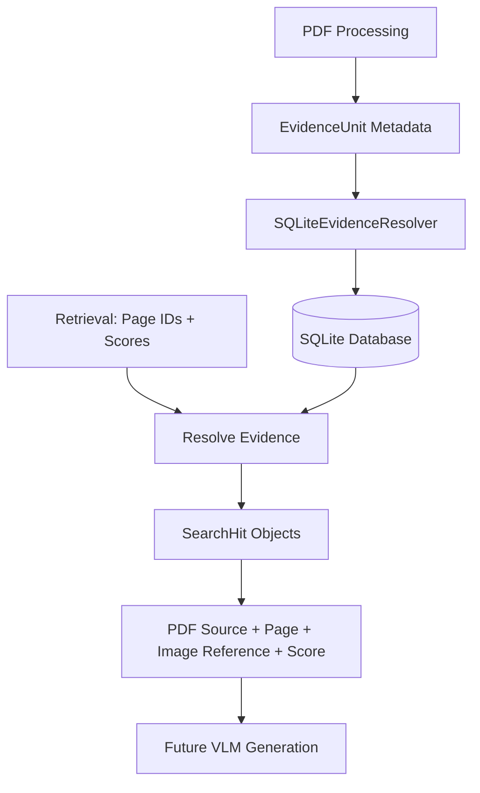

## SemanticLens Evidence

### Overview

The **Evidence module** connects retrieved results to their original documents and pages.

The Retrieval module returns page IDs and similarity scores. The Evidence module uses those IDs to recover the corresponding PDF source, page number, image reference, and metadata.

**V1 uses SQLite** for lightweight, persistent evidence storage.

This module also prepares the source references needed by the future **VLM answer-generation module**.

### How It Works



During indexing, evidence metadata is saved in SQLite. During searching, retrieved page IDs are matched with their saved metadata.

The resolver preserves the original retrieval order and scores.

### Module Structure

```text
semanticlens/evidence/
├── __init__.py
├── sqlite_resolver.py
└── README.md
```

| File | Purpose |
|---|---|
| `sqlite_resolver.py` | Stores and resolves evidence metadata using SQLite |
| `__init__.py` | Exposes the public API |
| `README.md` | Documents architecture and usage |

### Example Usage

```python
from semanticlens.evidence import SQLiteEvidenceResolver

resolver = SQLiteEvidenceResolver(
    workspace="./lens_data"
)

try:
    # Save evidence from PDF processing
    resolver.add(units)

    # Resolve ranked retrieval candidates
    hits = resolver.resolve(candidates)

    for hit in hits:
        print("PDF:", hit.evidence.document.source_uri)
        print("Page:", hit.evidence.page_number)
        print("Image:", hit.evidence.image_ref)
        print("Score:", hit.score)
finally:
    resolver.close()
```

*This example assumes `units` come from the Documents module and `candidates` come from Retrieval.*

### Output

The resolver returns a list of `SearchHit` objects.

Each result contains:

| Field | Description |
|---|---|
| `evidence.unit_id` | Unique evidence identifier |
| `evidence.document` | Original PDF source and document metadata |
| `evidence.page_number` | Human-readable page number, starting from 1 |
| `evidence.image_ref` | Workspace-relative reference to the page image |
| `evidence.text` | Optional extracted text |
| `evidence.metadata` | Additional evidence metadata |
| `score` | Similarity score from Retrieval |
| `retriever` | Name of the retrieval strategy |

Page numbers refer to the PDF's page order, which may differ from printed page labels

### SQLite Storage

By default, evidence metadata is stored at:

```text
lens_data/
├── pages/
│   └── ...
├── qdrant/
│   └── ...
└── evidence/
    └── evidence.sqlite3
```

SQLite stores serialized `EvidenceUnit` records **not page image bytes or vector embeddings**

The Documents, Embeddings and Evidence modules should use the same workspace so that page image references can be resolved correctly.

### Key Design Decisions

- **Persistent:** Evidence metadata survives application restarts
- **Lightweight:** Uses Python's built in `sqlite3` without additional dependencies
- **Interface-based:** Implements Core's `EvidenceResolver` contract
- **Complete provenance:** Preserves the original document and page information
- **Atomic writes:** Batch updates run inside SQLite transactions
- **Safe re-indexing:** Existing records are updated by `unit_id`
- **Strict resolution:** Missing or invalid evidence raises `EvidenceResolutionError`
- **Ranking preserved:** Results retain Retrieval's original order, scores and strategy names
- **Versioned storage:** Unrecognized database schemas are rejected rather than silently migrated

V1 is intended for sequential use. Each resolver instance owns a SQLite connection and should be used from the thread that created it.


### Future Extensions

The modular architecture allows future support for:

- Region level evidence and bounding boxes
- Figure and table references
- Richer provenance and citation formats
- Evidence filtering and source verification
- Alternative evidence storage backends
- Integration with VLM based answer generation

These features can be introduced without changing the basic evidence resolution workflow
