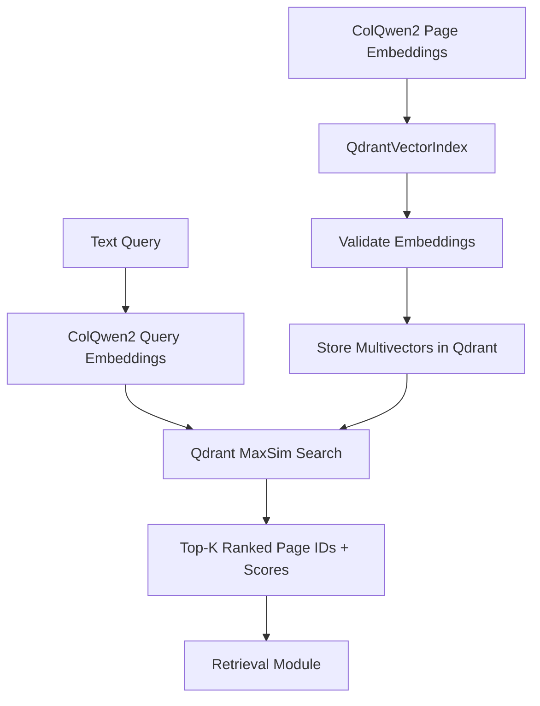

## SemanticLens Indexes

### Overview

The **Indexes module** stores document embeddings and searches them to find relevant evidence

Its purpose is to provide a **reliable, replaceable vector search system** for SemanticLens

**V1 uses Qdrant** to store ColQwen2 multivector embeddings and search them using MaxSim

### How It Works



The Retrieval module uses these results to identify relevant document pages

### What's Inside?

| File | Purpose |
|---|---|
| `config.py` | Configures local storage and collection name |
| `qdrant.py` | Stores embeddings and performs similarity search |
| `__init__.py` | Exposes the public API |

### Example Usage

```python
from semanticlens.indexes import QdrantConfig, QdrantVectorIndex

index = QdrantVectorIndex(
    config=QdrantConfig(
        path="./lens_data/qdrant",
        collection_name="ipcc_pages",
    ),
    spec=embedder.spec,
)

# Store page embeddings
index.upsert({
    "page-1": page_1_vectors,
    "page-2": page_2_vectors,
})

# Find relevant pages
results = index.search(query_vectors, top_k=5)

for page_id, score in results:
    print(page_id, score)

index.close()
```

> [!NOTE]
> Illustrative example. Embeddings are generated by the Embeddings module

### Key Design Decisions

- **Modular:** Implements Core's `VectorIndex` interface
- **Persistent:** Stores the index locally so it can be reused
- **Multivector support:** Preserves token level embeddings
- **MaxSim search:** Uses Qdrant's built in late interaction scoring
- **Compatibility checks:** Prevents incompatible embedding models from sharing an index
- **Stable IDs:** Connects stored vectors to SemanticLens evidence IDs
- **Extensible:** Other vector databases and indexing techniques can be added later

### V1 Configuration

| Property | Choice |
|---|---|
| Backend | Qdrant |
| Storage | Local persistent database |
| Embeddings | ColQwen2 multivectors |
| Vector dimensions | 128 |
| Similarity | Dot product + MaxSim |
| HNSW | Disabled |

The adapter derives vector settings from `EmbeddingSpec`, rather than hardcoding them
