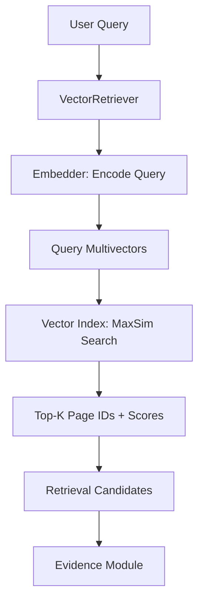

## SemanticLens Retrieval

### Overview

The **Retrieval module** connects user queries to the embedding model and vector index

It converts a text query into an embedding, searches for similar document pages and returns ranked evidence candidates

**V1 uses `VectorRetriever`**, a simple, single stage retrieval strategy compatible with ColQwen2 and Qdrant

### How It Works



The embedder generates query embeddings, while the index performs similarity scoring. The retriever coordinates both components without implementing their internal logic.

### Module Structure

```text
semanticlens/retrieval/
├── __init__.py
├── vector_retriever.py
└── README.md
```

| File | Purpose |
|---|---|
| `vector_retriever.py` | Implements Core's `Retriever` interface |
| `__init__.py` | Exposes the public API |
| `README.md` | Documents architecture and usage |

## Example Usage

```python
from semanticlens.core.schemas import Query
from semanticlens.embeddings import ColQwenEmbedder
from semanticlens.indexes import QdrantVectorIndex
from semanticlens.retrieval import VectorRetriever

embedder = ColQwenEmbedder(workspace="./lens_data")
index = QdrantVectorIndex(spec=embedder.spec)
retriever = VectorRetriever()

try:
    candidates = retriever.retrieve(
        Query(text="What causes global warming?"),
        embedder=embedder,
        index=index,
        top_k=5,
    )

    for candidate in candidates:
        print(candidate.unit_id, candidate.score)
finally:
    index.close()
    embedder.close()
```

> [!NOTE]
> *This example assumes the Qdrant collection already contains indexed document pages*

### Output

The retriever returns a list of `RetrievalCandidate` objects

Each candidate contains:

| Field | Description |
|---|---|
| `unit_id` | Identifier of the matching document page |
| `score` | Similarity score returned by the vector index |
| `retriever` | Retrieval strategy identifier (`"vector"`) |

Results preserve the ranking and scores provided by the index.

The **Evidence module** later resolves these page IDs into their original documents, page numbers, and source metadata.

### Key Design Decisions

- **Interface-based:** Implements Core's `Retriever` contract.
- **Stateless:** Does not store embeddings, search results, or database connections.
- **Model-independent:** Works with any compatible `Embedder`.
- **Backend-independent:** Works with any compatible `VectorIndex`.
- **Compatibility checks:** Verifies that the embedder and index use matching `EmbeddingSpec` values.
- **Result validation:** Rejects malformed matches, duplicate evidence IDs, and invalid similarity scores.
- **No unnecessary configuration:** Core already provides `top_k` and the required components.

### Responsibilities

| Component | Responsibility |
|---|---|
| Embeddings | Generate query embeddings |
| Indexes | Store vectors and calculate similarity |
| Retrieval | Coordinate search and return ranked candidates |
| Evidence | Resolve candidates to source documents and pages |

The Retrieval module does **not** perform MaxSim calculations, manage Qdrant collections or generate answers

### Future Extensions

The modular architecture allows additional retrieval strategies including:

- Hybrid visual and text retrieval
- Multi stage retrieval
- Candidate reranking
- Query expansion
- Experimental retrieval algorithms

These strategies can be implemented as separate retrievers without changing the existing V1 behavior
